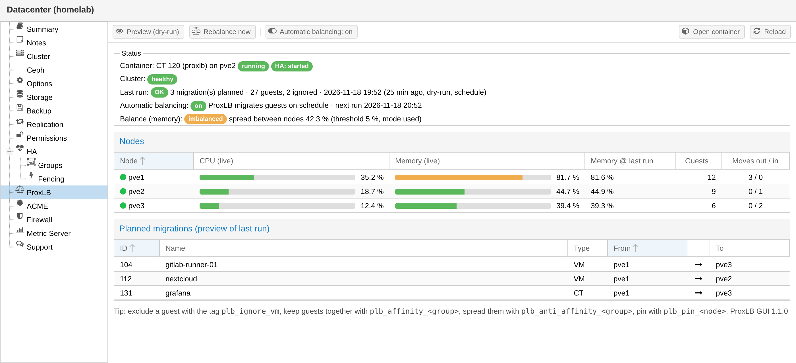

# Add the ProxLB plugin to Proxmox VE and connect it to ProxLB

This guide shows how to add the **ProxLB** tab to the Proxmox VE web interface
(*Datacenter → ProxLB*) and connect it to a ProxLB instance. It covers a new
install, and connecting a ProxLB container you already have.



- [How the plugin talks to ProxLB](#how-the-plugin-talks-to-proxlb)
- [Step 1 - Add the plugin to the web interface](#step-1---add-the-plugin-to-the-web-interface)
- [Step 2 - Connect the plugin to ProxLB](#step-2---connect-the-plugin-to-proxlb)
- [Step 3 - Check the connection](#step-3---check-the-connection)
- [Who may see and use the tab](#who-may-see-and-use-the-tab)
- [Troubleshooting](#troubleshooting)
- [Remove](#remove)

---

## How the plugin talks to ProxLB

The plugin needs **no extra port, URL, password or certificate**. It finds
ProxLB through the normal Proxmox API, with the session of whoever is logged in:

```
 Browser: Datacenter → ProxLB  (proxlb-gui.js)
     │  1. find the container with the tag  "proxlb"     (/cluster/resources)
     │  2. read its Notes = status written by the agent  (/nodes/<node>/lxc/<id>/config)
     │  3. buttons add a tag: proxlb-cmd-dryrun | proxlb-cmd-run | proxlb-active
     ▼
 Proxmox VE API
     ▲
     │  4. proxlb-agent polls the tags every ~10 s, runs ProxLB,
     │     writes the result into the container Notes
 LXC container (tag "proxlb")
     proxlb-agent  →  python -m proxlb -j [-d]  →  migrations through the API
```

So "connecting" the plugin to ProxLB means:

1. ProxLB runs in an **LXC container that has the tag `proxlb`**,
2. **`proxlb-agent`** runs in that container,
3. the agent's API token may **edit that container's Notes and tags**
   (`VM.Config.Options` on `/vms/<CTID>`).

`proxlb-lxc` sets all of this up for you ([Step 2A](#a-new-container-recommended)).
For a container you already have, see [Step 2B](#b-connect-an-existing-proxlb-container).

> If several containers have the tag `proxlb`, the plugin uses the one with the lowest ID.

---

## Step 1 - Add the plugin to the web interface

The plugin is a JavaScript file loaded by the web interface of **each node**.
Install it on every node whose web interface you open; otherwise the tab only
appears there. Pick **one** of these options.

### Option A - `.deb` package (recommended)

On **every** node, as root:

```bash
wget https://github.com/jwklijnsma/ProxLB/releases/download/proxlb-pve-nightly/proxlb-pve_latest_all.deb
apt install ./proxlb-pve_latest_all.deb
```

The package enables the tab right away and **puts it back automatically after
every `pve-manager` update**. It also brings the `proxlb-lxc` and `proxlb-gui`
commands. For a fixed version, use a `v*` release from the
[releases page](https://github.com/jwklijnsma/ProxLB/releases).

### Option B - script, all nodes at once

On **one** node, as root (uses the cluster's root SSH to reach the others):

```bash
git clone https://github.com/jwklijnsma/ProxLB.git
bash ProxLB/contrib/proxmox/gui/install-gui.sh --all-nodes
```

An apt hook puts the tab back after `pve-manager` updates. If you later
install the `.deb`, it takes over from the script install by itself.

### Option C - together with the container

`proxlb-lxc` (Step 2A) also installs the plugin on all nodes, unless you pass `--no-gui`.

### See the tab

1. Reload the web interface **without cache**: `Ctrl+F5` (macOS: `Cmd+Shift+R`).
2. Click **Datacenter** → **ProxLB**, just below *HA*.

Until ProxLB is connected, the tab shows **"not installed - No container with the tag proxlb found"**. That's expected: go to Step 2.

Check on a node from the shell:

```bash
grep proxlb-gui /usr/share/pve-manager/index.html.tpl      # one <script> line
ls -l /usr/share/pve-manager/js/proxlb-gui.js
```

---

## Step 2 - Connect the plugin to ProxLB

### A. New container (recommended)

On **one** node, as root:

```bash
proxlb-lxc --ip 192.168.1.50/24 --gw 192.168.1.1        # with the .deb package
# or: bash ProxLB/contrib/proxmox/proxlb-lxc.sh --ip ... # from git
```

Important options: `--storage`, `--bridge`, `--vlan`, `--interval`, `--method`,
`--balanciness`, and `--active` (balance for real at once). `--no-ha` skips
Proxmox HA. See `proxlb-lxc --help`.

This creates everything the plugin needs:

| Part | Value |
|---|---|
| Container | unprivileged Debian, tags `proxlb` and `plb_ignore_vm` (ProxLB never moves itself) |
| API user / token | `proxlb@pve!lxc<CTID>` |
| Roles | `ProxLB` on `/` (Datastore.Audit, Sys.Audit, VM.Audit, VM.Migrate), `ProxLBAgent` on `/vms/<CTID>` (VM.Config.Options) |
| Inside the CT | ProxLB in `/opt/proxlb/venv`, `proxlb-agent.service`, `/etc/proxlb/proxlb.yaml`, `/etc/proxlb/agent.yaml` |

About 30 seconds after the container starts, the agent has done its first dry-run
and the tab fills up. Continue with [Step 3](#step-3---check-the-connection).

### B. Connect an existing ProxLB container

You already run ProxLB in an LXC container, for example from the upstream
`proxlb` .deb or pip. These steps make the plugin use it. Below, `<CTID>` is the
container ID, and `proxlb@pve!mytoken` is the API token in your `proxlb.yaml`.

**1. Tag the container.** Do this on any node:

```bash
pct config <CTID> | grep ^tags                   # note any tags you already have
pct set <CTID> --tags "proxlb;plb_ignore_vm"      # replaces the list: add your old tags here too
```

`plb_ignore_vm` stops ProxLB from migrating its own container mid-run.

**2. Allow the token to write the status and read commands.** Run this on any node:

```bash
pveum role add ProxLBAgent --privs VM.Config.Options
pveum acl modify /vms/<CTID> --users proxlb@pve --roles ProxLBAgent
# only if the token has privilege separation (privsep=1):
pveum acl modify /vms/<CTID> --tokens 'proxlb@pve!mytoken' --roles ProxLBAgent
```

ProxLB itself still needs its usual rights on `/`: Datastore.Audit, Sys.Audit, VM.Audit and VM.Migrate.

**3. Install the agent in the container.** Run this on the node that runs the CT:

```bash
git clone --depth 1 https://github.com/jwklijnsma/ProxLB.git /tmp/ProxLB
pct push <CTID> /tmp/ProxLB/contrib/proxmox/agent/proxlb-agent.py /opt/proxlb-agent.py --perms 0755
pct push <CTID> /tmp/ProxLB/contrib/proxmox/agent/proxlb-ctl /usr/local/bin/proxlb-ctl --perms 0755
pct push <CTID> /tmp/ProxLB/contrib/proxmox/agent/proxlb-agent.service /etc/systemd/system/proxlb-agent.service
```

If the `.deb` is installed, the same files are under `/usr/share/proxlb-pve/src/contrib/proxmox/agent/`.

**4. Configure the agent.** Run these inside the container (`pct enter <CTID>`). First,
find the Python that has ProxLB installed:

| ProxLB installed with | Python |
|---|---|
| upstream `proxlb` .deb | `/opt/venvs/proxlb/bin/python3` |
| `proxlb-lxc` | `/opt/proxlb/venv/bin/python` |
| pip into a venv | `<venv>/bin/python` |

```bash
PY=/opt/venvs/proxlb/bin/python3          # <- your Python from the table
cat > /etc/proxlb/agent.yaml <<EOF
ctid: <CTID>
proxlb_config: /etc/proxlb/proxlb.yaml
python: $PY
poll_seconds: 10
run_timeout_seconds: 14400
state_dir: /var/lib/proxlb
pause_when_degraded: true
EOF
id plb >/dev/null 2>&1 || useradd --system --user-group --home-dir /var/lib/proxlb --shell /usr/sbin/nologin plb
install -d -o plb -g plb /var/lib/proxlb
chgrp plb /etc/proxlb/proxlb.yaml /etc/proxlb/agent.yaml && chmod 0640 /etc/proxlb/*.yaml

# the unit file expects the proxlb-lxc paths - point it at yours
sed -i "s#^ExecStart=.*#ExecStart=$PY /opt/proxlb-agent.py -c /etc/proxlb/agent.yaml#" \
    /etc/systemd/system/proxlb-agent.service
```

**5. Let the agent run ProxLB instead of the daemon.** Only one of them may
schedule runs:

```bash
systemctl disable --now proxlb.service 2>/dev/null || true
systemctl daemon-reload
systemctl enable --now proxlb-agent.service
journalctl -u proxlb-agent -f                 # wait for "ProxLB run finished"
```

The agent takes the interval from `service.schedule` in your `proxlb.yaml`.
`service.daemon` and `service.enable_ha` are ignored. Your other settings stay as they are.

> **Safe by default:** scheduled runs are only dry-runs until you switch on
> **Automatic balancing** in the tab. If your old daemon balanced for real, switch it on there.
>
> **API host:** the agent tries every entry of `proxmox_api.hosts` in turn.
> List all nodes there, so it keeps working when one node is down.

---

## Step 3 - Check the connection

Reload *Datacenter → ProxLB*. A connected setup looks like this:

| Line | Expected |
|---|---|
| **Container** | `CT <id> (proxlb) on <node>`, **running**, `HA: started` (or `HA: off`) |
| **Last run** | `OK - N migration(s) planned`, with a recent time |
| **Automatic balancing** | `off` (dry-run only) until you switch it on, plus the next run time |
| **Cluster** | `healthy` |
| **Balance** | `balanced` or `imbalanced`, with the spread between nodes |

Then press **Preview (dry-run)**. The status shows *command queued*, then
*dry-run running*, and within about 10-30 seconds a new *Last run* time.
**The connection works when that round trip completes.**

The container's own **Notes** (*CT → Summary*) also show a short summary,
written by the agent.

---

## Who may see and use the tab

| To ... | the user needs |
|---|---|
| see *Datacenter → ProxLB* | `Sys.Audit` on `/` (e.g. role `PVEAuditor`) |
| press *Preview*, *Rebalance now* or *Automatic balancing* | `VM.Config.Options` on `/vms/<CTID>` |

Example: a group **proxlb-operators** that may watch and operate ProxLB, but nothing else:

```bash
pveum group add proxlb-operators
pveum acl modify / --groups proxlb-operators --roles PVEAuditor
pveum role add ProxLBOperator --privs VM.Config.Options 2>/dev/null || true
pveum acl modify /vms/<CTID> --groups proxlb-operators --roles ProxLBOperator
pveum user modify alice@pve --groups proxlb-operators
```

If you restricted tags (*Datacenter → Options → Tag Style → User Allow*), also
allow the tags `proxlb-cmd-dryrun`, `proxlb-cmd-run` and `proxlb-active` for these users.

---

## Troubleshooting

| The tab shows ... | Cause / fix |
|---|---|
| **no ProxLB entry** under Datacenter | The plugin is not loaded on *this* node. Check `grep proxlb-gui /usr/share/pve-manager/index.html.tpl`, then `Ctrl+F5`. Re-apply with `proxlb-gui --reapply` (package) or `bash install-gui.sh`. You also need `Sys.Audit` on `/`. |
| **not installed - no container with the tag proxlb** | Plugin OK, ProxLB not connected: [Step 2](#step-2---connect-the-plugin-to-proxlb). Check the tag with `pct config <CTID> \| grep tags`. |
| container shown, **Last run: No run yet** for minutes | The agent isn't running or can't write the Notes. Look at `pct exec <CTID> -- journalctl -u proxlb-agent -n 50`. *"could not publish status"* means `VM.Config.Options` on `/vms/<CTID>` is missing (Step 2B.2). |
| **agent not responding** | No update for more than 15 minutes: the agent stopped or lost the API. Run `pct exec <CTID> -- systemctl status proxlb-agent` and check `proxmox_api.hosts`. |
| **Last run: failed - ...** | The message is ProxLB's own error, often API rights or an unreachable host. See `pct exec <CTID> -- proxlb-ctl last`. |
| **command queued** that never finishes | The agent doesn't pick up tags: it's stopped, or it watches another CTID (`ctid:` in `/etc/proxlb/agent.yaml`). |
| **Rebalance now** greyed out | The cluster is degraded (node offline or HA recovering), so balancing is paused on purpose. Or a run is in progress. |
| buttons give **permission denied** | The user lacks `VM.Config.Options` on `/vms/<CTID>`, or tags are restricted ([see above](#who-may-see-and-use-the-tab)). |
| tab gone after a Proxmox update | Script install: the apt hook should re-apply it, so run `proxlb-gui --reapply`. The `.deb` does this through its dpkg trigger. |

Useful commands inside the container: `proxlb-ctl status | last | logs | dryrun | run | config`.

---

## Remove

```bash
apt remove proxlb-pve                                        # package, on each node
bash ProxLB/contrib/proxmox/gui/install-gui.sh --uninstall --all-nodes   # script install
```

This removes only the tab. ProxLB keeps running in its container. To remove
the container too, run `pct destroy <CTID>`, then remove the API user and roles:
`pveum user delete proxlb@pve`, `pveum role delete ProxLB`, `pveum role delete ProxLBAgent`.
